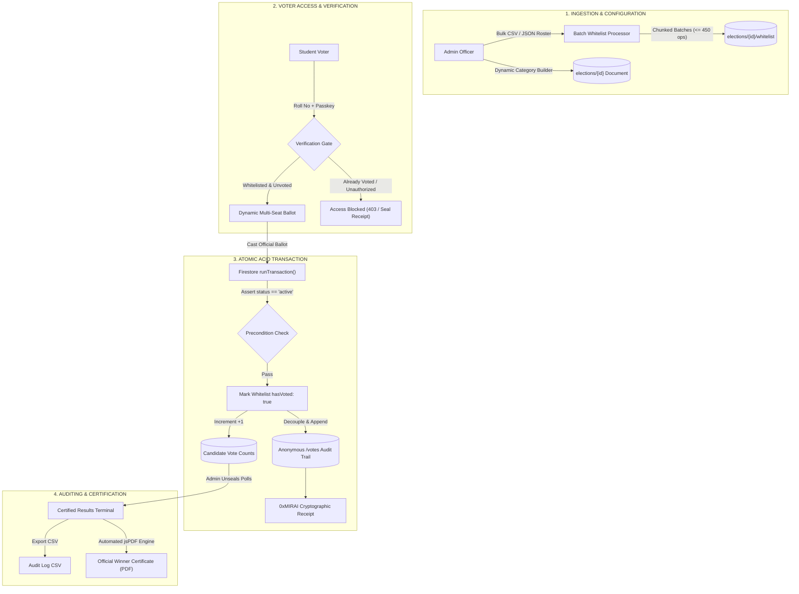

# 🗳️ Mirai Vote Hub
### Institutional Multi-Tenant Electoral Ledger & Autonomous Voting Infrastructure
**Mirai School of Technology — Department of Computer Science & Engineering (AI & ML)**

---

<p align="center">
  <a href="https://mirai-election-portal.web.app">
    
  </a>
  
  
  
  
</p>

---

## 🌐 Official Production Deployment

| Environment | Production URL | Status | Network |
|---|---|---|---|
| **Live Portal** | **[https://mirai-election-portal.web.app](https://mirai-election-portal.web.app)** | `ACTIVE (99.9% SLA)` | Google Global Edge CDN |
| **Backup Domain** | `https://mirai-election-portal.firebaseapp.com` | `STANDBY` | Firebase Multi-Region |

> **Direct Access:** All students, faculty, and election observers can access the live portal directly at **[https://mirai-election-portal.web.app](https://mirai-election-portal.web.app)** across any smartphone, tablet, or desktop browser.

---

## 🏛️ Executive Overview

**Mirai Vote Hub** is a multi-tenant, zero-dummy-data election platform engineered specifically for the **Department of Computer Science & Engineering (AI & ML) at Mirai School of Technology**. Built on the foundational pillars of cryptographic ballot secrecy decoupling, strict identity authentication, atomic concurrency control, and dynamic multi-seat representation, the system guarantees 100% electoral integrity, eliminates duplicate voting, and provides real-time auditability alongside automated post-election certification.

```
========================================================================================
       __  __ _____ ____      _    ___  __     _____ _____ _____   _   _ _   _ ____  
      |  \/  |_   _|  _ \    / \  |_ _| \ \   / / _ \_   _| ____| | | | | | | | __ ) 
      | |\/| | | | | |_) |  / _ \  | |   \ \ / / | | || | |  _|   | |_| | | | |  _ \ 
      | |  | | | | |  _ <  / ___ \ | |    \ V /| |_| || | | |___  |  _  | |_| | |_) |
      |_|  |_| |_| |_| \_\/_/   \_\___|    \_/  \___/ |_| |_____| |_| |_|\___/|____/ 
                                                                                        
         [ DEPARTMENT OF COMPUTER SCIENCE & ENGINEERING - ARTIFICIAL INTELLIGENCE ]
               [ OFFICIAL CLASS REPRESENTATIVE (CR) ELECTION INFRASTRUCTURE ]
========================================================================================
```

---

## 🚀 Key Technological Capabilities

### 1. 🛡️ Cryptographic Ballot Secrecy & Voter Decoupling
- **Zero-Linkage Audit Architecture**: Voter identity validation is strictly segregated from candidate ballot selection.
- When an authorized student casts their ballot, their whitelist document in `whitelist/{rollNo}` is stamped with `hasVoted: true` and a cryptographically unique receipt token.
- Concurrently, the chosen candidate selections are appended into an isolated, anonymous collection (`/votes/{anonymousVoteId}`) completely stripped of roll numbers, names, or identifying metadata.

### 2. ⚡ Atomic Concurrency Engine (`runTransaction`)
- High-concurrency elections with hundreds of simultaneous voters are executed through **Firestore ACID Transactions**.
- Double-tap and network contention guards disable submission buttons instantly (`"Securing Ballot on Ledger..."`).
- Optimistic locking validates election status (`active`), verifies deadlines (`closesAt`), confirms whitelist eligibility (`hasVoted === false`), and checks candidate category integrity before committing state mutations.

### 3. 🎨 Dynamic Multi-Seat Category Architecture
- Beyond standard Boy CR and Girl CR roles, administrators can define arbitrary electoral seats (e.g., *Technical Secretary*, *Sports Captain*, *Club President*).
- The ballot booth dynamically generates multi-column voter interfaces with real-time selection validation and stage trackers.

### 4. 🌓 Dual Light / Dark Theme Engine
- High-contrast, accessibility-compliant theme engine powered by CSS Custom Properties (`var(--bg-primary)`, `var(--text-primary)`, `var(--accent-cyan)`).
- Instant, zero-FOUC (Flash of Unstyled Content) initialization persisted through `localStorage`.

### 5. 📜 Automated Winner Certificate & Audit Reports
- **Dynamic PDF Certificates**: Embedded with official high-resolution, transparently cropped institutional emblems using client-side **jsPDF** vector rendering.
- **Certified Audit CSV**: Comprehensive multi-category vote share reports exportable in a single click with SHA-like verification receipts.

### 6. ⏱️ Flexible Lifecycle Controls & Auto-Lock Timers
- Supports **Manual Close** or **Timed Auto-Lock** (with live synchronized countdown clocks).
- **Strict Results Privacy**: Live telemetry displays zero vote tallies while voting is active. Results remain cryptographically sealed until an Admin publishes them.

### 7. 🗄️ Archive Ledger & Cascade Deep-Delete
- Soft-archive elections out of public view with instant one-click restoration.
- Safe, chunked cascade deletion capable of removing thousands of whitelist records and candidate profiles in batched slices of 450 operations without exceeding database limits.

---

## 🧰 Comprehensive Tech Stack

| Domain | Technology / Library | Purpose & Implementation |
|---|---|---|
| **Core Architecture** | **Vanilla ES6+ JavaScript (ESM)** | Zero-bloat, ultra-fast modular architecture without heavy frontend framework overhead |
| **Cloud Database** | **Google Cloud Firestore (v10.8.0 Modular)** | Real-time listeners (`onSnapshot`), Atomic Transactions (`runTransaction`), and batched writes (`writeBatch`) |
| **Authentication** | **Firebase Auth & Roll-Key Verification** | Secure anonymous Firebase sessioning coupled with student university credentials and SHA-256 PIN hashing |
| **Hosting & Edge** | **Firebase Hosting (Global CDN)** | High-speed global edge network with custom cache headers (`max-age=3600` for assets/JS/CSS, `no-cache` for `index.html`) |
| **Styling & UI** | **Custom CSS3 Design System** | Cyberpunk-inspired institutional glassmorphism, responsive grid layout, and light/dark theme variables |
| **PDF Generation** | **jsPDF (v2.5.1)** | Client-side vector certificate generator with dynamic winner typography and official university crests |
| **Icons & Typography** | **Google Fonts (Outfit & JetBrains Mono)** | Clean modern typography paired with high-readability monospace font for cryptographic tokens and roll keys |
| **Security Rules** | **Firestore Security Rules Engine** | Fine-grained access control enforcing single vote increments, self-only credential edits, and immutable vote trails |

---

## 📐 System Architecture & Data Flow



---

## 📁 Repository File Layout

```
mirai-vote-hub/
├── assets/
│   ├── mirai-logo.png              # High-res transparent institutional emblem
│   └── mirai-logo.webp             # Optimized web asset
├── css/
│   └── style.css                   # Unified CSS design system & dual-theme tokens
├── js/
│   ├── firebase-config.js          # Modular Firebase v10 initialization & credentials
│   ├── auth.js                     # Student credential authentication & session state
│   ├── voting.js                   # Atomic transaction engine, ballot builder & concurrency guards
│   ├── results.js                  # Certified results renderer, CSV exporter & PDF certificate generator
│   └── admin.js                    # Management terminal, category builder, chunked importer & deep delete
├── firebase.json                   # Hosting configuration, cache-control headers & rules link
├── firestore.rules                 # Production Firestore security & permission specifications
├── index.html                      # Single-Page Web Application entry point
└── README.md                       # Complete technical handbook & operations guide
```

---

## 🔒 Cloud Firestore Security Specifications

| Resource Path | Read | Write / Mutation Constraints | Security Purpose |
|---|---|---|---|
| `/users/{studentId}` | Public | Update only if `request.resource.data.rollNo == studentId` | First-time student claiming & PIN updates |
| `/elections/{electionId}` | Public | Admin lifecycle management | Multi-tenant election catalog and configuration |
| `/elections/{electionId}/whitelist/{studentId}` | Public | Update permitted only if `hasVoted: false -> true` or Admin reset | Strict duplicate prevention; console tamper protection |
| `/elections/{electionId}/candidates/{candId}` | Public | Increment strictly by `+1` while parent status is `active` | Anti-tamper vote tallying |
| `/elections/{electionId}/votes/{voteId}` | Public | Append-only (`allow create`); updates blocked | Decoupled anonymous ballot ledger |
| `/votes/{voteId}` | Public | Append-only (`allow create`); updates & deletes blocked | Global immutable audit trail |
| `/election_meta/{metaId}` | Public | Full Admin write | Global telemetry and system config |

---

## 🛠️ Local Development & Deployment

### Prerequisites
- [Node.js (v18+)](https://nodejs.org/)
- [Firebase CLI](https://firebase.google.com/docs/cli) (`npm install -g firebase-tools`)
- Modern web browser with ES module support

### 1. Clone & Run Locally
```bash
# Clone the repository
git clone https://github.com/Ayush-git800/mirai-vote-hub.git
cd mirai-vote-hub

# Start a local static server
python3 -m http.server 3000

# Open in browser:
# http://localhost:3000
```

### 2. Deploy to Firebase
```bash
# Authenticate with Google / Firebase
firebase login

# Set active project
firebase use mirai-election-portal

# Deploy Firestore Security Rules
firebase deploy --only firestore:rules

# Deploy Web App to Firebase Hosting
firebase deploy --only hosting
```

Your live election portal will instantly be reachable at:
👉 **[https://mirai-election-portal.web.app](https://mirai-election-portal.web.app)**

---

## 👥 Institutional Administration

**Mirai School of Technology**  
*Department of Computer Science & Engineering (Artificial Intelligence & Machine Learning)*  
Academic Session 2026–2027  

- **Lead Engineer & Maintainer:** Ayush ([@Ayush-git800](https://github.com/Ayush-git800))
- **Live URL:** [https://mirai-election-portal.web.app](https://mirai-election-portal.web.app)
- **License:** MIT License — Free for institutional educational use.
